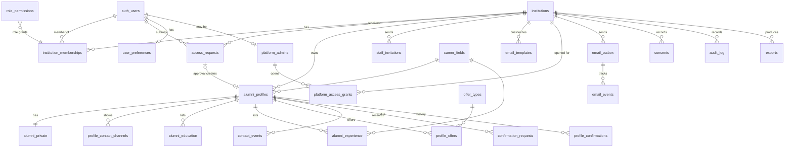

# Data model v2

The target schema for the clean baseline migration (FND-04) and its access rules (FND-05). It implements the decisions of 2026-10-26 ([DECISIONS.md](../DECISIONS.md)) and replaces PRODUCT_ANALYSIS §6 and the target ERDs 21–26 in `documentation/diagrams/`.

**Issue:** AUDIT-09 · **Feeds:** FND-04 (schema), FND-05 (RLS + RPCs), FND-06 (isolation tests)

## 1. Principles

1. **Every school is independent** (ADR 0002). Every school-owned row carries `institution_id`. Nothing joins across schools. `auth.users` is the only shared table and holds no school data.
2. **Clients read, RPCs write.** The `authenticated` role gets `SELECT` through RLS and nothing else. Every insert, update and delete goes through a `security definer` RPC that checks permission on its first line and writes `audit_log`. This removes the whole class of "owner rewrites system columns" bugs (F5) and keeps multi-table saves atomic (F14).
3. **Public and private data live in different tables or rows.** Directory-safe columns are in `alumni_profiles`. Private columns are in `alumni_private`. Email and phone are rows of `profile_contact_channels` that members can never select (F3, F4).
4. **Explicit state.** Status and visibility are enums. Nothing is inferred from nulls.
5. **Permissions are data.** `role_permissions` maps roles to permissions, and `has_permission(institution_id, permission)` is the only check policies and RPCs use (ADR 0005).
6. **Built for the CSV import later.** `access_requests.source` and a nullable `alumni_profiles.user_id` let a future import feed the same approval queue without a schema rewrite (ADR 0004).
7. **No raw secrets at rest.** Tokens are stored as SHA-256 hashes. The email outbox stores ids, never links with tokens; the worker mints tokens at send time.

## 2. Enums

| Enum | Values | Notes |
|---|---|---|
| `member_role` | `school_admin`, `reviewer`, `alumni`, `student` | `student` grants nothing until ST1 |
| `member_status` | `active`, `suspended`, `revoked` | Memberships exist only after approval or a staff invitation |
| `request_status` | `pending`, `needs_info`, `approved`, `rejected`, `withdrawn` | |
| `request_source` | `signup`, `import` | `import` is unused until the CSV import |
| `profile_status` | `active`, `suspended`, `archived`, `deceased`, `deleted` | `deleted` = self-deleted, waiting for the 30-day purge |
| `profile_visibility` | `hidden`, `members` | New profiles are `hidden` (F13) |
| `channel_type` | `email`, `phone`, `linkedin`, `facebook`, `instagram`, `website` | `email` and `phone` are *private channels* |
| `locale` | `en`, `fr` | |
| `email_template_key` | `access_approved`, `access_needs_info`, `access_rejected`, `welcome`, `staff_invitation`, `annual_confirmation`, `confirmation_reminder_1`, `confirmation_reminder_2` | School-editable. Auth emails (confirm sign-up, reset, email change) are platform templates and are not editable |
| `template_status` | `draft`, `approved` | |
| `email_status` | `queued`, `sending`, `sent`, `delivered`, `bounced`, `complained`, `failed`, `suppressed`, `skipped_no_template` | |
| `confirmation_source` | `onboarding`, `alumnus_save`, `alumnus_still_accurate` | Only alumnus actions confirm (DEC-06, E5) |
| `consent_document` | `terms`, `privacy_policy`, `directory_publication` | |

## 3. Tables

Conventions for every table:
- `id uuid default gen_random_uuid()`, unless noted.
- `created_at timestamptz not null default now()`.
- Mutable tables also have `updated_at` maintained by a trigger.
- RLS is on everywhere, and `anon` has no grants on any table.

### 3.1 Tenancy and identity

| Table | Columns | Constraints and notes |
|---|---|---|
| `institutions` | `name`, `slug`, `status` (`active`/`suspended`), `default_locale`, `reply_to_email`, `email_display_name`, `branding` jsonb (logo path, colours), `confirmation_interval_months` int default 12, `custom_domain` null | `slug` unique, `^[a-z0-9-]{2,40}$`. `custom_domain` unique (later). |
| `platform_admins` | `user_id` PK → `auth.users`, `created_by` | System admins (Gab, Noah). Not school members. |
| `platform_access_grants` | `user_id` → `platform_admins`, `institution_id`, `reason`, `expires_at`, `revoked_at` | `expires_at <= created_at + 8 h`. Read-only access while active. Visible to the school's admins. |
| `institution_memberships` | `institution_id`, `user_id` → `auth.users`, `role`, `status`, `status_reason`, `status_changed_by`, `status_changed_at` | Unique (`institution_id`, `user_id`). One role per person per school. |
| `role_permissions` | `role`, `permission` | PK (`role`, `permission`). Seeded by the migration (§4). |
| `staff_invitations` | `institution_id`, `email`, `role` (`school_admin`/`reviewer`), `token_hash`, `expires_at` (7 days), `invited_by`, `accepted_by`, `accepted_at`, `revoked_at` | `token_hash` unique. One open invitation per (`institution_id`, lower(`email`)). |
| `user_preferences` | `user_id` PK → `auth.users`, `locale` | Language choice (DEC-07). Not school data, so it isn't per school. |

### 3.2 Sign-up and approval

| Table | Columns | Constraints and notes |
|---|---|---|
| `access_requests` | `institution_id`, `user_id` → `auth.users`, `source`, `email` (snapshot), `first_name`, `last_name`, `maiden_name`, `grad_year`, `note`, `status`, `info_request` (admin's question), `applicant_reply`, `decision_reason`, `decided_by`, `decided_at`, `profile_id` (set on approval) | One open request per user per school: partial unique (`institution_id`, `user_id`) where `status in ('pending','needs_info')`. `grad_year` between 1900 and the current year + 1. Rejected rows are deleted after 90 days (DEC-08). |

The duplicate hints admins see come from a view, `access_request_duplicates`: same `lower(email)`, or same normalized name and `grad_year` as an existing profile or another open request. Nothing in it is shown to applicants (S4).

### 3.3 Profiles (DEC-02)

| Table | Columns | Constraints and notes |
|---|---|---|
| `alumni_profiles` | `institution_id`, `user_id` null, `status`, `visibility`, `first_name`, `last_name`, `preferred_name`, `grad_year`, `city`, `country`, `bio`, `job_title`, `employer`, `career_field_id`, `career_field_other`, `languages` text[], `onboarding_step`, `onboarding_completed_at`, `published_at`, `last_confirmed_at`, `confirmation_due_at`, `deleted_at` | Unique (`institution_id`, `user_id`). `first_name`, `last_name` and `grad_year` required. `bio` ≤ 1,000 chars. **Only directory-safe columns.** `user_id` is always set at launch; null is reserved for imported, not-yet-claimed records. |
| `alumni_private` | `profile_id` PK → `alumni_profiles`, `institution_id`, `maiden_name`, `admin_notes`, `school_student_id` | 1:1. The owner and staff only. `maiden_name` is admin-only (DEC-02). |
| `profile_contact_channels` | `profile_id`, `institution_id`, `type`, `value`, `is_public`, `sort_order` | Unique (`profile_id`, `type`). Optional (DEC-02): zero rows means "No contact details shared". Value formats are checked per type (email, E.164 phone, https URL). |
| `alumni_education` | `profile_id`, `institution_id`, `school`, `degree`, `field_of_study`, `graduation_year`, `sort_order` | |
| `alumni_experience` | `profile_id`, `institution_id`, `job_title`, `employer`, `career_field_id`, `location`, `start_year`, `end_year`, `is_current`, `sort_order` | `end_year >= start_year`. Not both `end_year` and `is_current`. |
| `career_fields` | `institution_id` null, `key`, `label_en`, `label_fr`, `sort_order`, `is_active` | Null `institution_id` = platform default. Seeded from `lib/profile-options.ts`. |
| `offer_types` | `institution_id` null, `key`, `label_en`, `label_fr`, `audience` (`alumni`/`students`/`both`), `sort_order`, `is_active` | Seeded from `HELP_OPTIONS`. |
| `profile_offers` | `profile_id`, `offer_type_id`, `institution_id` | PK (`profile_id`, `offer_type_id`). Replaces `availability_flags`. |

`confirmation_due_at` = `last_confirmed_at + institutions.confirmation_interval_months`. It is set by the same RPCs that set `last_confirmed_at`, and indexed for the daily job.

### 3.4 Contact and freshness

| Table | Columns | Constraints and notes |
|---|---|---|
| `contact_events` | `institution_id`, `initiator_user_id`, `recipient_profile_id`, `channel` | Written only by `initiate_contact`. One event per (initiator, recipient, channel) per 24 h. No daily limit (DEC-03). |
| `confirmation_requests` | `institution_id`, `profile_id`, `due_at`, `token_hash`, `status` (`open`/`confirmed`/`superseded`), `reminders_sent` 0–2, `last_sent_at`, `confirmed_at` | One open request per profile (partial unique). Superseded when the alumnus saves their profile first. |
| `profile_confirmations` | `institution_id`, `profile_id`, `source`, `actor_user_id` | Append-only history. Staff edits never insert here (E5). |

### 3.5 Email (ADR 0007)

| Table | Columns | Constraints and notes |
|---|---|---|
| `email_templates` | `institution_id` null, `key`, `locale`, `status`, `subject`, `body`, `edited_by`, `approved_by`, `approved_at` | Unique (`institution_id`, `key`, `locale`, `status`), so a school has at most one draft and one approved version. Null `institution_id` = platform default. `body` is plain text with `{placeholders}`; a check rejects `<` and unknown placeholders. |
| `email_outbox` | `institution_id`, `template_key`, `locale`, `to_email`, `to_user_id`, `subject_id` (the request, profile or invitation it concerns), `status`, `attempts`, `next_attempt_at`, `last_error`, `provider_message_id`, `sent_at` | `id` is Resend's idempotency key. No rendered body and no token stored. |
| `email_events` | `outbox_id`, `provider_message_id`, `type`, `occurred_at`, `payload` jsonb | From signed Resend webhooks. |
| `email_suppressions` | `email` (lower), `reason` (`bounce`/`complaint`/`manual`), `source_event_id` | Unique (`email`). Platform-wide, because a bad address is bad for every school. |

### 3.6 Governance and operations

| Table | Columns | Constraints and notes |
|---|---|---|
| `consents` | `institution_id`, `user_id`, `document`, `version`, `accepted_at`, `withdrawn_at` | Law 25 evidence. Publishing requires an active `directory_publication` consent. |
| `audit_log` | `id` bigint identity, `institution_id` null, `actor_user_id`, `actor_kind` (`member`/`system_admin`/`system`), `action`, `target_type`, `target_id`, `metadata` jsonb | Append-only: `update`/`delete` revoked and blocked by a trigger. Kept 2 years. Metadata holds ids and changed field names, not values. |
| `exports` | `institution_id`, `requested_by`, `filters` jsonb, `format` (`csv`/`xlsx`), `row_count`, `storage_path`, `expires_at`, `downloaded_at` | Files live in a private bucket and are deleted after 24 h. |
| `rate_limit_counters` | `key`, `window_start`, `count` | PK (`key`, `window_start`). For sign-up, login and request throttles. |
| `job_runs` | `job`, `started_at`, `finished_at`, `status`, `stats` jsonb, `error` | Heartbeat for the missed-job alert. |

**Future, not in the baseline:** `invitations`, `import_batches` and `import_rows` (CSV import), `messages` and `reports` (relay messaging), and `student_profiles`.

## 4. Roles and permissions

`role_permissions` seed (ADR 0005):

| Permission | school_admin | reviewer | alumni |
|---|:-:|:-:|:-:|
| `directory.use` | ✓* | ✓* | ✓ |
| `requests.read` · `requests.decide` | ✓ | ✓ | |
| `records.read` | ✓ | ✓ | |
| `records.edit` | ✓ | | |
| `records.export` | ✓ | | |
| `audit.read` · `freshness.read` · `metrics.read` | ✓ | ✓ | |
| `templates.manage` | ✓ | | |
| `staff.manage` | ✓ | | |
| `settings.manage` | ✓ | | |

\* `directory.use` also requires an `active` profile owned by the caller, so staff without an alumni profile can't browse the directory.

Helper functions are all `stable`, `security definer`, with `search_path = ''`:
- `has_permission(inst, perm)`: true when the caller has an `active` membership in `inst` whose role holds `perm`. It also covers a system admin with an active grant for `inst`, but only for `*.read` permissions.
- `is_system_admin()`.
- `my_profile_id(inst)`.

## 5. Access matrix (RLS)

S = `SELECT` policy. Every write is through an RPC (§6), so no table has insert, update or delete policies. "Visible profile" = `status = 'active'` and `visibility = 'members'`.

| Table | Anon | Alumni (same school) | Owner of the row | Reviewer | School admin | System admin |
|---|---|---|---|---|---|---|
| `institutions` | via `public_school(slug)` only | S own school | | S | S | S all |
| `institution_memberships` | | | S own | S school | S school | S all |
| `access_requests` | | | S own | S school | S school | grant only |
| `alumni_profiles` | | S visible | S own | S school | S school | grant only |
| `alumni_private` | | | S own | S school | S school | grant only |
| `profile_contact_channels` | | S visible profile, `is_public`, link types only | S own | S school | S school | grant only |
| education · experience · offers | | S if parent visible | S own | S school | S school | grant only |
| `career_fields` · `offer_types` | | S global + school | S | S | S | S |
| `contact_events` | | S own as initiator | | S school (`metrics.read`) | S school | grant only |
| `confirmation_requests` · `profile_confirmations` | | | S own | S school | S school | grant only |
| `email_templates` | | | | | S school + defaults | S all |
| `email_outbox` · `email_events` | | | | S school (failures) | S school | S all |
| `staff_invitations` | | | | | S school | S all |
| `consents` | | | S own | | S school | grant only |
| `audit_log` | | | | S school | S school | S all |
| `exports` | | | | | S own | |
| `platform_*`, `email_suppressions`, `rate_limit_counters`, `job_runs` | | | | | | S |

"Grant only" means read access only while a `platform_access_grants` row for that school is active. Each read session opening is audited.

## 6. RPC catalog

All RPCs are `security definer` and `set search_path = ''`. Each one:
- starts with its permission check;
- takes the school from the request host (resolved server-side and passed as `p_institution`), then checks it against the caller's membership, never trusting it on its own;
- has `execute` revoked from `public` and `anon` unless the table below says anon.

| RPC | Caller | What it does |
|---|---|---|
| `public_school(slug)` | anon | Name, branding and locale for the landing page. Aggregate stats only above a minimum count. |
| `request_access(inst, payload)` | authenticated, email verified | Creates or updates the caller's open request (`source = 'signup'`). Rate-limited. Same response whatever exists (S4). |
| `reply_to_info_request(request_id, reply)` | request owner | Moves `needs_info` back to `pending`. |
| `withdraw_access_request(request_id)` | request owner | |
| `decide_access_request(request_id, decision, reason?, link_profile_id?)` | `requests.decide` | `approve` creates the profile, private row and active membership (or links `link_profile_id`, kept for the import), sets `last_confirmed_at`, and queues `access_approved`. `needs_info` and `reject` queue their emails. One transaction, audited, refuses already-decided requests. |
| `save_my_profile(inst, payload jsonb)` | profile owner | Profile, private fields, channels, education, experience and offers in one transaction, validated server-side. Records a confirmation (`alumnus_save`), resets `confirmation_due_at` and supersedes any open confirmation request (DEC-06). |
| `set_my_visibility(inst, visibility)` | profile owner | Publishing needs a completed onboarding and an active consent. |
| `confirm_still_accurate(token)` / `confirm_still_accurate_in_app(inst)` | token holder / owner | POST only (scanner-safe, E6). |
| `initiate_contact(profile_id, channel)` | `directory.use` | Same school, visible target, public channel. Returns the value, logs `contact_events` with a 24 h dedupe. |
| `search_directory(inst, filters, page)` | `directory.use` | Combined filters (name, class, career field, offer, city, school, language) over visible profiles. Returns directory-safe columns only. |
| `admin_update_profile(profile_id, patch)` | `records.edit` | Never touches `last_confirmed_at`. |
| `set_profile_status(profile_id, status, reason)` | `records.edit` | Suspend, reactivate, archive, mark deceased. |
| `invite_staff(inst, email, role)` · `accept_staff_invitation(token)` · `change_staff_role(...)` · `remove_staff(...)` | `staff.manage` / invitee | The last school admin can't be demoted or removed. |
| `save_email_template(inst, key, locale, subject, body)` · `approve_email_template(...)` | `templates.manage` | Validates placeholders. Approval replaces the previous approved version. |
| `update_school_settings(inst, patch)` | `settings.manage` | Branding, reply-to, default language, career fields and offers. |
| `create_export(inst, filters, format)` | `records.export` | Writes `exports`; the file is built server-side. |
| `delete_my_profile(inst)` · `export_my_data(inst)` | profile owner | Sets `status = 'deleted'`. The purge job removes it within 30 days; the auth user goes only when no membership remains (ADR 0002). |
| `platform_create_school(...)` · `platform_appoint_school_admin(...)` · `platform_open_grant(inst, reason, hours)` | system admin | |
| `enqueue_email(...)`, `claim_outbox_batch(n)`, `record_email_event(...)` | service role only | Used by the worker and webhooks. |

## 7. Jobs

| Job | Schedule | Work |
|---|---|---|
| `email-sweeper` | every 5 min | Retries queued and failed outbox rows with backoff (5 attempts). |
| `freshness` | daily 14:00 UTC | Opens confirmation requests for profiles past `confirmation_due_at` and sends reminders at +14 and +30 days. Skips schools whose template isn't approved. |
| `retention` | daily | Purges `deleted` profiles after 30 days, rejected requests after 90 days, export files after 24 h, and `audit_log`/`email_events` after 2 years (DEC-08). |
| `grants` | hourly | Marks expired platform grants (RLS already ignores them). |

Each job writes `job_runs`. A missing run raises an alert (OPS-03).

## 8. Indexes

- `alumni_profiles`:
  - (`institution_id`, `status`, `visibility`)
  - (`institution_id`, `grad_year`)
  - (`institution_id`, `career_field_id`)
  - (`confirmation_due_at`) where `status = 'active'`
  - a GIN trigram index on `lower(first_name || ' ' || last_name || ' ' || coalesce(preferred_name, ''))`
- `profile_offers` (`offer_type_id`) and `alumni_education` (lower(`school`)), for the filters.
- `access_requests` (`institution_id`, `status`, `created_at`).
- `contact_events` (`institution_id`, `created_at`) and (`initiator_user_id`, `recipient_profile_id`, `channel`, `created_at`).
- `email_outbox` (`status`, `next_attempt_at`).
- `audit_log` (`institution_id`, `created_at`).

Targets come from AUDIT-06: `search_directory` p95 under 300 ms at 10k profiles per school (QA-06).

## 9. ERD

## 10. From the legacy schema

Production holds only demo and test data, so there is no data migration (ADR 0003). The seed is rebuilt for v2 (FND-14).

| Legacy | v2 |
|---|---|
| `member_role` `super_admin` / `institution_admin` | `platform_admins` / `school_admin` (+ `reviewer`) |
| `alumni_profiles.claim_email` | gone (no claim by email). The account email lives in `auth.users`; the request snapshot in `access_requests.email`. |
| `is_directory_visible` + `privacy_preset` | `visibility` |
| `claimed_at` / null `user_id` checks | `status` and memberships |
| `profession`, `industry` | `career_field_id` (+ `career_field_other`); `industry` dropped |
| `universities[]`, `degrees[]` | `alumni_education` rows |
| `linkedin_url`, `website_url`, `contact_allowed` | `profile_contact_channels` rows |
| `availability_flags.*` | `profile_offers` → `offer_types` |
| `alumni_experience.career_field` text | `career_field_id` |
| `invitations`, `claim_my_profile()`, `find_claimable_profile()` | removed (CSV import and invitations are Future) |
| `access_requests` (nullable `institution_id`, no needs-info) | `access_requests` v2 (`institution_id` not null, `source`, `needs_info`, decision fields) |

## 11. Findings this design closes

| Finding | How |
|---|---|
| F2 anon `approve_access_request` | All RPC `execute` grants are explicit; `anon` gets only `public_school`. |
| F3 column leak | Private data moved out of `alumni_profiles`; email and phone are unreadable rows. |
| F4 child-table leak | Child policies check the parent profile is visible. |
| F5 owners rewrite system columns | No client write policies; writes only via RPCs. |
| F6 email enumeration | No email lookup RPC; `request_access` responds the same way every time. |
| F13 visible by default | `visibility` defaults to `hidden`; publishing needs consent. |
| F14 non-atomic saves | `save_my_profile` is one transaction. |
| F16 approval undefined | `decide_access_request` with explicit states. |
| F20 single-admin assumption | Several `school_admin`s; permission checks per school. |
| F21 reconfirmation missing | `confirmation_requests`, `profile_confirmations` and the freshness job. |
| F23 hard-coded tenant | No school literal anywhere; the school comes from the host. |

## 12. Resolved questions (2026-10-27)

1. **Staff browsing the directory:** staff get directory access only if they also have an approved alumni profile at that school. Admin pages are separate and don't need one.
2. **Platform grants:** read-only at launch. If support needs to fix data, a school admin does it. A write scope can be added later.
3. **Templates per language:** if a school hasn't approved the template in the recipient's language, the email goes out in the other approved language. If neither is approved, nothing is sent (`skipped_no_template`) and the admin sees why.
