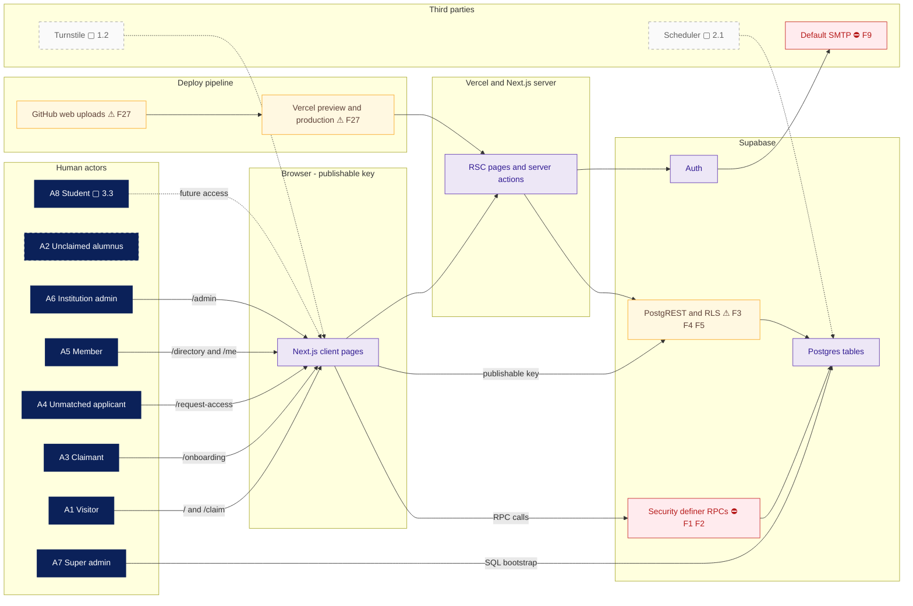

# System context and actor map

Current trust boundaries and planned external services. The browser uses the publishable key to call Supabase directly, so row policies and RPC permissions are security boundaries. A2 is an imported data subject with no outgoing interactions.

## Notes

- **F1** — The repo no longer matches the live database.
- **F2** — `approve_access_request` runs for anonymous callers.
- **F3** — Members can read every column of every visible profile.
- **F4** — Child tables leak hidden and unclaimed profiles.
- **F5** — Owners can rewrite system columns.
- **F9** — Auth emails don't work for real alumni.
- **F27** — Engineering hygiene.
- **1.2** — Non-enumerating claim: `/claim` → `request_claim_link(email)` always shows the same message, emails a link if there is a match, and otherwise offers verification; Turnstile and rate limiting.
- **2.1** — Reconfirmation nudges: a daily job finds profiles past `next_reconfirm_due_at` and emails a signed one-click "Still accurate" link plus an "Update" link. Reminders follow, and after N of them the profile is flagged stale or auto-hidden (configurable per school). (F21).
- **3.3** — Student role: the school verifies students, who see only alumni with `student_contact_allowed`.
