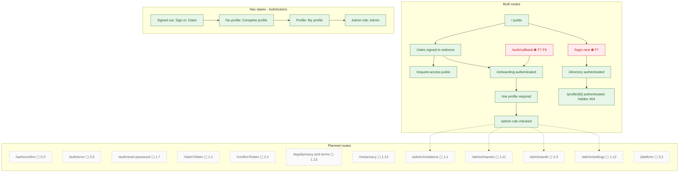

# Sitemap, guards, and navigation states

Routes and redirects reflect the current App Router pages. Planned destinations are shown separately; they do not exist in the repository.

## Notes

- **F7** — Open redirect.
- **F9** — Auth emails don't work for real alumni.
- **0.5** — `/auth/confirm` (`verifyOtp` with `token_hash`) and an `/auth/error` page; keep `/auth/callback` for OAuth only.
- **1.1** — Invitation system: `create_invitations(profile_ids)` stores token hashes; a server action with the secret key sends branded emails; `/claim?token=` landing page; expiry, resend and revoke; invite status in the roster.
- **1.7** — `/auth/reset-password` page (`updateUser`) and the recovery redirect.
- **1.11** — Admin import v2: server-side; more columns (maiden name, phone, school student ID); validation and preview; upsert and dedupe; per-row errors; `import_batches`.
- **1.12** — Admin roster actions: view and edit any record, suspend or reactivate, archive or delete, mark deceased, resend invite; fix the multi-membership query.
- **1.13** — Legal pages and consent capture; self-service account deletion and data export (Law 25 portability).
- **2.1** — Reconfirmation nudges: a daily job finds profiles past `next_reconfirm_due_at` and emails a signed one-click "Still accurate" link plus an "Update" link. Reminders follow, and after N of them the profile is flagged stale or auto-hidden (configurable per school). (F21).
- **2.3** — Audit-log writes for every admin and security action, plus an admin viewer.
- **3.2** — Platform-admin console: create an institution, invite its admins, usage.
