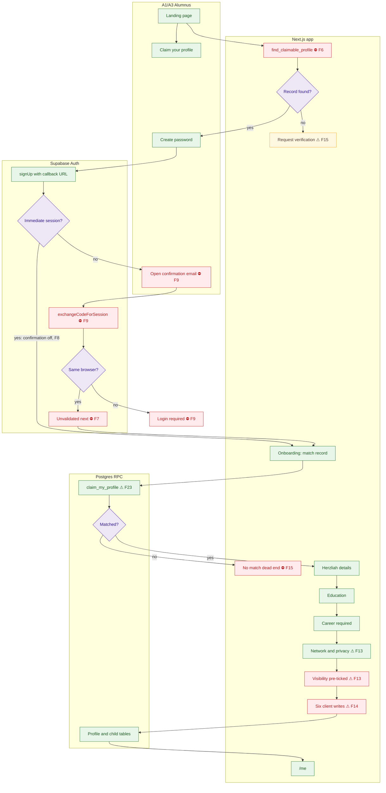

# First-time claim: current flow

The as-built flow starts with an anonymous email lookup and ends with several client writes. Confirmation delivery and cross-device callbacks are deployment risks documented in the product analysis; the callback also accepts an unvalidated next parameter.

## Notes

- **F6** — Email enumeration on `/claim`.
- **F7** — Open redirect.
- **F8** — The claim depends entirely on email confirmation.
- **F9** — Auth emails don't work for real alumni.
- **F13** — Visibility defaults to on, against the spec.
- **F14** — Profile saves are not atomic.
- **F15** — Signed-in unmatched users hit a dead end.
- **F23** — The tenant is hard-coded.
