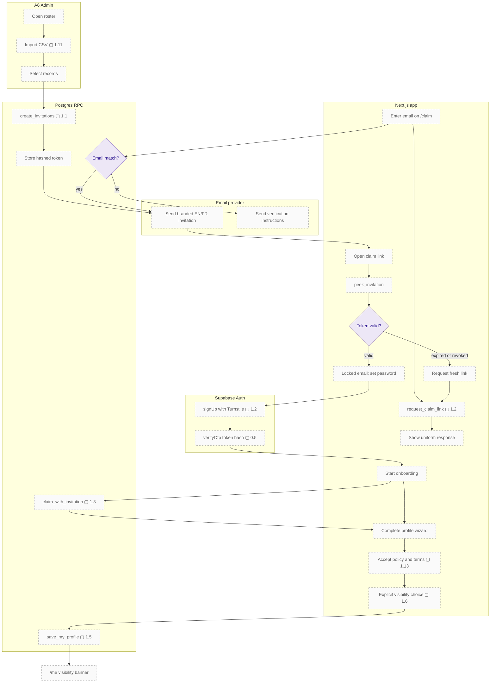

# First-time claim: invitation target

The target claim path begins with an admin-issued invitation and uses a token linked to an imported record. Password confirmation can complete on another device, and profile visibility starts hidden until the alumnus explicitly opts in.

## Notes

- **0.5** — `/auth/confirm` (`verifyOtp` with `token_hash`) and an `/auth/error` page; keep `/auth/callback` for OAuth only.
- **1.1** — Invitation system: `create_invitations(profile_ids)` stores token hashes; a server action with the secret key sends branded emails; `/claim?token=` landing page; expiry, resend and revoke; invite status in the roster.
- **1.2** — Non-enumerating claim: `/claim` → `request_claim_link(email)` always shows the same message, emails a link if there is a match, and otherwise offers verification; Turnstile and rate limiting.
- **1.3** — `claim_with_invitation(token)`: the tenant comes from the token. Keep tenant-aware email-match as a fallback.
- **1.5** — `save_my_profile(payload jsonb)`, one transaction, used by both onboarding and `/me`.
- **1.6** — Visibility model: one `visibility` enum (`hidden` / `members` / `admins_only`), default `hidden`, an explicit opt-in step, consent recorded.
- **1.11** — Admin import v2: server-side; more columns (maiden name, phone, school student ID); validation and preview; upsert and dedupe; per-row errors; `import_batches`.
- **1.13** — Legal pages and consent capture; self-service account deletion and data export (Law 25 portability).
