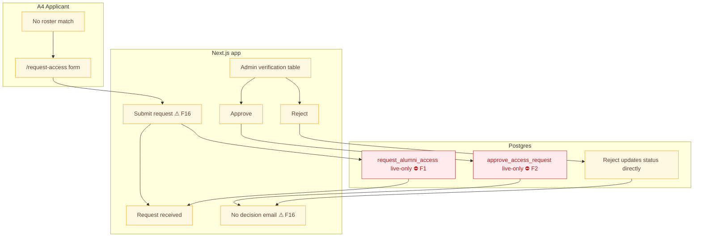
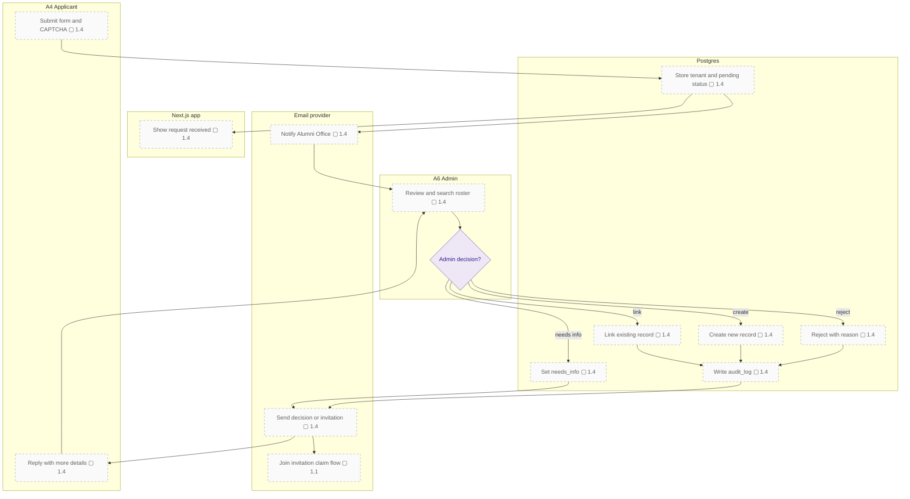

# Verification request lifecycle

The first diagram shows the current request form and admin actions, including the unversioned live RPCs. The second shows a target lifecycle that links or creates a record, sends a decision email, and issues an invitation.

### Target flow

### Current limitations

- `approve_access_request` is live-only and callable by `anon` before its request lookup; the rest of its authorization and outcome are unverified (F2, F16).
- Signed-in unmatched users have no path to this form (F15). An `institution_id` of NULL would hide requests from institution admins (F16).

## Notes

- **F1** — The repo no longer matches the live database.
- **F2** — `approve_access_request` runs for anonymous callers.
- **F15** — Signed-in unmatched users hit a dead end.
- **F16** — Access-request approval is undefined.
- **1.1** — Invitation system: `create_invitations(profile_ids)` stores token hashes; a server action with the secret key sends branded emails; `/claim?token=` landing page; expiry, resend and revoke; invite status in the roster.
- **1.4** — Access-request lifecycle: on approve, the admin links an existing record or creates one, and an invitation goes out automatically. On reject, an email with the reason. An "ask for more info" state. Store `institution_id`. A CTA from the onboarding no-match screen.
