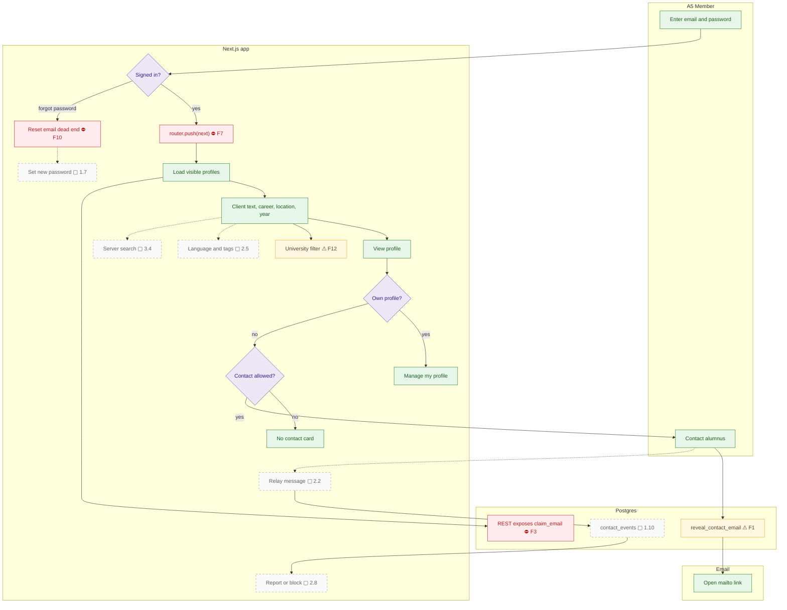

# Member search and contact

Members sign in, filter visible profiles, and can reveal a contact email through an unversioned RPC. The target relay sends a message without exposing the recipient address.

## Notes

- **F1** — The repo no longer matches the live database.
- **F3** — Members can read every column of every visible profile.
- **F7** — Open redirect.
- **F10** — Password reset is a dead end.
- **F12** — The University filter ignores real alumni.
- **1.7** — `/auth/reset-password` page (`updateUser`) and the recovery redirect.
- **1.10** — Contact v1 hardened: `reveal_contact_email` checks `contact_allowed` and membership, logs to `contact_events`, and enforces a daily limit.
- **2.2** — "Message via the Network" relay (in the design): a form on the profile; the platform sends the email with `Reply-To` set to the sender, so the recipient's address is never exposed. Rate limits, report and block.
- **2.5** — Expertise tags (in the design); languages and graduating-decade filters.
- **2.8** — Report a profile or message; admin moderation queue.
- **3.4** — Server-side search and pagination (Postgres FTS or `pg_trgm`) beyond about 5k profiles.
