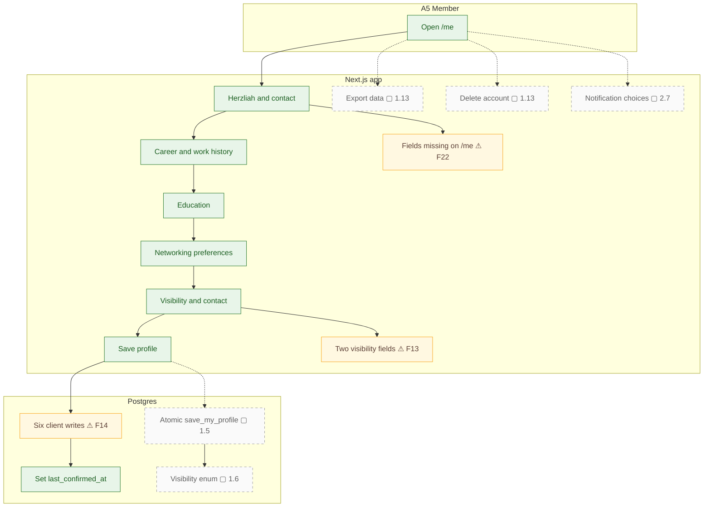
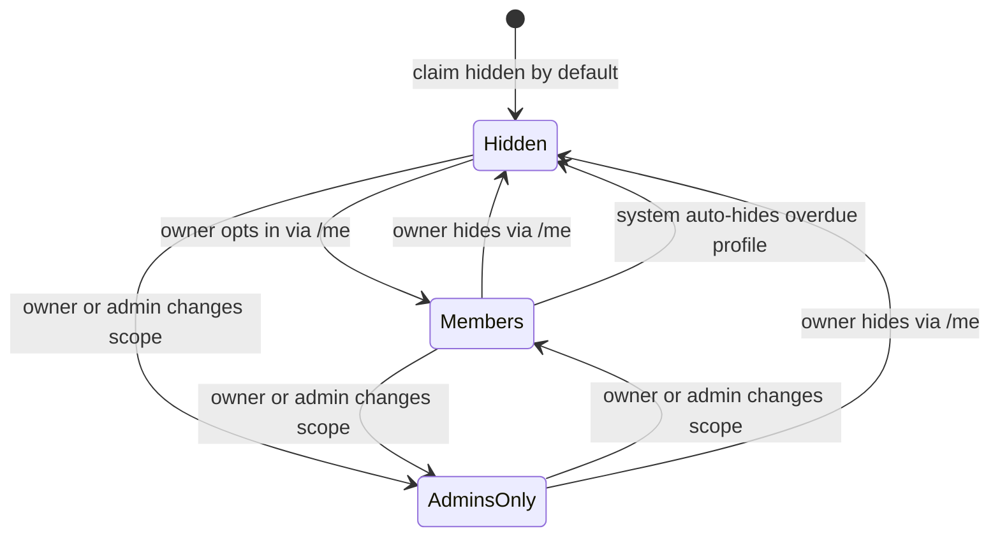

# Profile management and privacy

The current profile editor has separate writes for the profile, flags, education, and experience. The target replaces these with a single transaction and adds explicit visibility and data rights.

### Target visibility states

## Notes

- **F13** — Visibility defaults to on, against the spec.
- **F14** — Profile saves are not atomic.
- **F22** — Onboarding and profile fields don't line up.
- **1.5** — `save_my_profile(payload jsonb)`, one transaction, used by both onboarding and `/me`.
- **1.6** — Visibility model: one `visibility` enum (`hidden` / `members` / `admins_only`), default `hidden`, an explicit opt-in step, consent recorded.
- **1.13** — Legal pages and consent capture; self-service account deletion and data export (Law 25 portability).
- **2.7** — Notification preferences and one-click unsubscribe (CASL).
