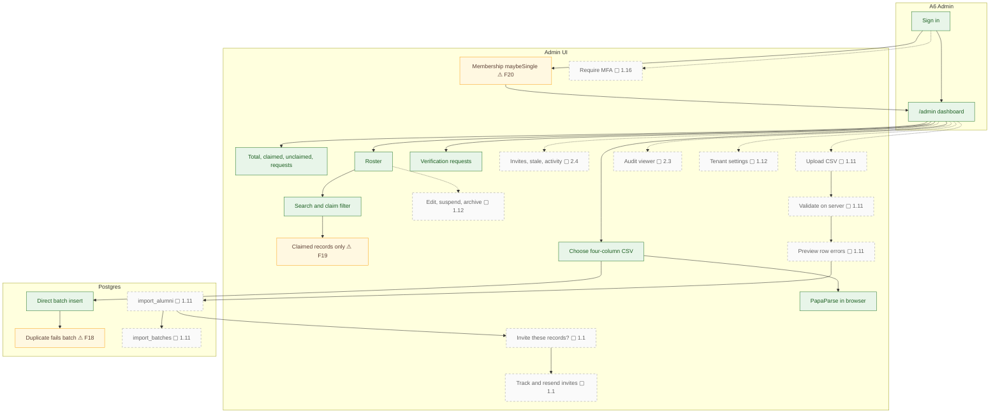

# Institution admin operations

The current admin dashboard supports counts, roster search, a four-column browser CSV import, and verification decisions. Planned actions add invitations, server validation, settings, and an audit viewer.

## Notes

- **F18** — CSV import is minimal.
- **F19** — Admins can't act on records.
- **F20** — The admin page assumes one admin membership.
- **1.1** — Invitation system: `create_invitations(profile_ids)` stores token hashes; a server action with the secret key sends branded emails; `/claim?token=` landing page; expiry, resend and revoke; invite status in the roster.
- **1.11** — Admin import v2: server-side; more columns (maiden name, phone, school student ID); validation and preview; upsert and dedupe; per-row errors; `import_batches`.
- **1.12** — Admin roster actions: view and edit any record, suspend or reactivate, archive or delete, mark deceased, resend invite; fix the multi-membership query.
- **1.16** — Super-admin bootstrap script instead of hand-run SQL; MFA enforced for admins.
- **2.3** — Audit-log writes for every admin and security action, plus an admin viewer.
- **2.4** — Dashboard metrics: % claimed, invites pending or expired, stale profiles, recent activity (in the design).
