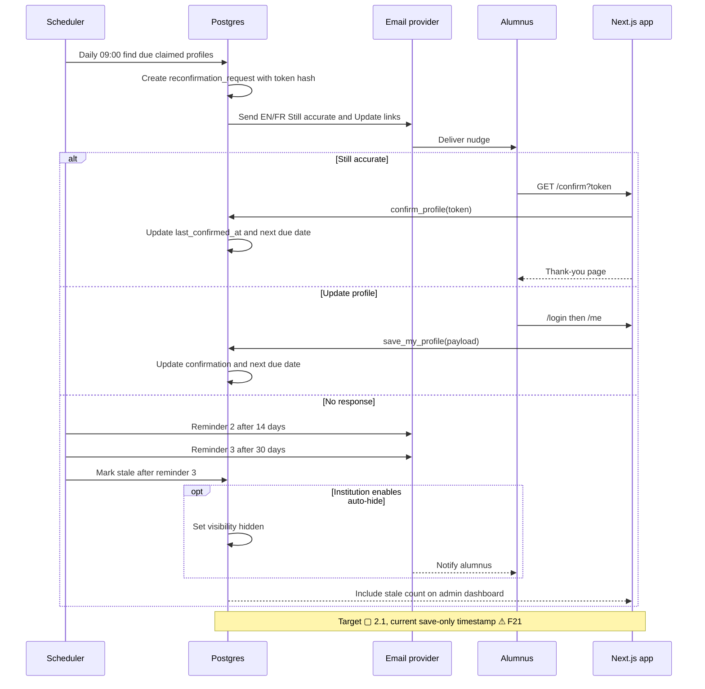

# Reconfirmation nudge lifecycle

This is a planned phase 2 flow. The current application updates `last_confirmed_at` only when an alumnus saves their profile.

## Notes

- **F21** — The twice-yearly reconfirmation is not built.
- **2.1** — Reconfirmation nudges: a daily job finds profiles past `next_reconfirm_due_at` and emails a signed one-click "Still accurate" link plus an "Update" link. Reminders follow, and after N of them the profile is flagged stale or auto-hidden (configurable per school). (F21).
