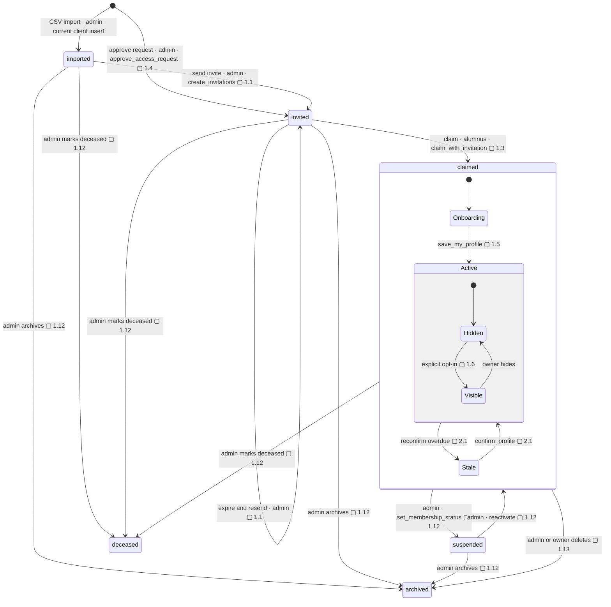

# Alumni record lifecycle

The target uses an explicit `profile_status` enum and separate visibility states. Today the state is inferred from `user_id` and `claimed_at`; only four-column import and `claim_my_profile` exist.

## Notes

- **1.1** — Invitation system: `create_invitations(profile_ids)` stores token hashes; a server action with the secret key sends branded emails; `/claim?token=` landing page; expiry, resend and revoke; invite status in the roster.
- **1.3** — `claim_with_invitation(token)`: the tenant comes from the token. Keep tenant-aware email-match as a fallback.
- **1.4** — Access-request lifecycle: on approve, the admin links an existing record or creates one, and an invitation goes out automatically. On reject, an email with the reason. An "ask for more info" state. Store `institution_id`. A CTA from the onboarding no-match screen.
- **1.5** — `save_my_profile(payload jsonb)`, one transaction, used by both onboarding and `/me`.
- **1.6** — Visibility model: one `visibility` enum (`hidden` / `members` / `admins_only`), default `hidden`, an explicit opt-in step, consent recorded.
- **1.12** — Admin roster actions: view and edit any record, suspend or reactivate, archive or delete, mark deceased, resend invite; fix the multi-membership query.
- **1.13** — Legal pages and consent capture; self-service account deletion and data export (Law 25 portability).
- **2.1** — Reconfirmation nudges: a daily job finds profiles past `next_reconfirm_due_at` and emails a signed one-click "Still accurate" link plus an "Update" link. Reminders follow, and after N of them the profile is flagged stale or auto-hidden (configurable per school). (F21).
