# Platform admin and new-school onboarding

The README documents manual creation of a `super_admin` membership after creating an Auth user. The target adds a platform console and resolves each tenant from the incoming hostname.

```mermaid
flowchart TD
subgraph Developer[Developer - current]
developer["Create Auth user"] --> dashboard["Supabase dashboard"] --> sql["Hand-written super_admin SQL"]
end
subgraph Platform[Platform admin - target]
console["Platform console ▢ 3.2"] --> institution["Create institution ▢ 3.2"] --> lookups["Seed career and offer options ▢ 3.5"] --> firstadmin["Invite first admin ▢ 3.2"] --> mfa["Admin claims with MFA ▢ 1.16"] --> importcsv["Import roster ▢ 1.11"]
end
subgraph Routing[Tenant routing - target]
host["Incoming hostname"] --> resolve["Resolve custom domain ▢ 3.1"] --> context["Tenant context for RPCs ▢ 3.1"]
literal["Hard-coded Herzliah ⚠ F23"]
end
context -.-> literal
classDef built fill:#E8F5E9,stroke:#2E7D32,color:#1B5E20
classDef partial fill:#FFF8E1,stroke:#F9A825,color:#5D4037
classDef broken fill:#FFEBEE,stroke:#C62828,color:#B71C1C
classDef todo fill:#FAFAFA,stroke:#9E9E9E,stroke-dasharray:5 5,color:#616161
classDef actor fill:#0B2159,stroke:#0B2159,color:#FFFFFF
classDef system fill:#EDE7F6,stroke:#5E35B1,color:#311B92
class developer partial
class dashboard partial
class sql partial
class console todo
class institution todo
class lookups todo
class firstadmin todo
class mfa todo
class importcsv todo
class host todo
class resolve todo
class context todo
class literal partial
```

## Notes

- **F23** — The tenant is hard-coded.
- **1.11** — Admin import v2: server-side; more columns (maiden name, phone, school student ID); validation and preview; upsert and dedupe; per-row errors; `import_batches`.
- **1.16** — Super-admin bootstrap script instead of hand-run SQL; MFA enforced for admins.
- **3.1** — Tenant resolution by subdomain or custom domain; remove every `'herzliah'` literal; per-tenant branding from `institutions`.
- **3.2** — Platform-admin console: create an institution, invite its admins, usage.
- **3.5** — Per-tenant career fields and "open to" options with EN/FR labels (lookup tables, §6).
