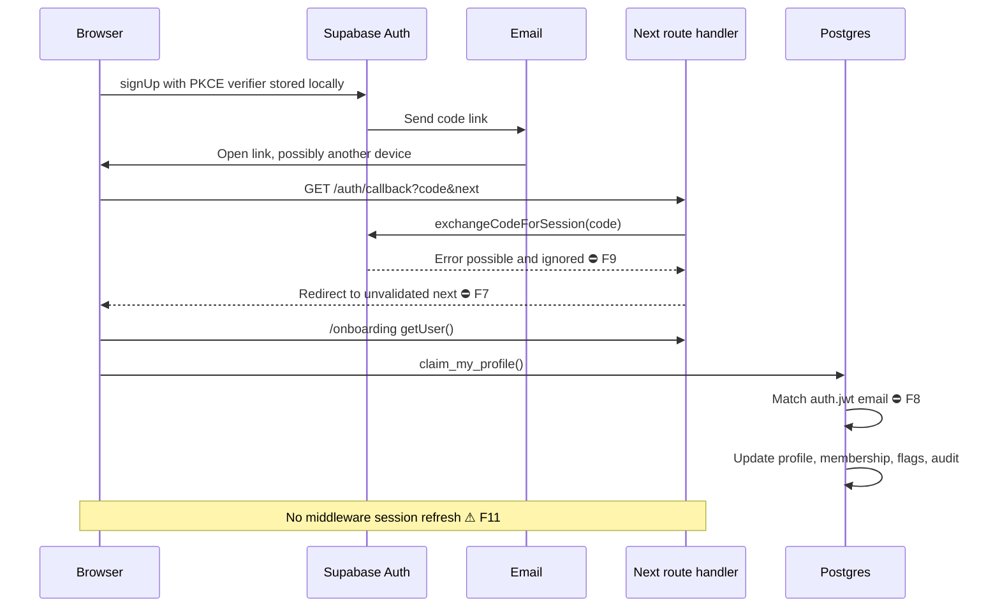
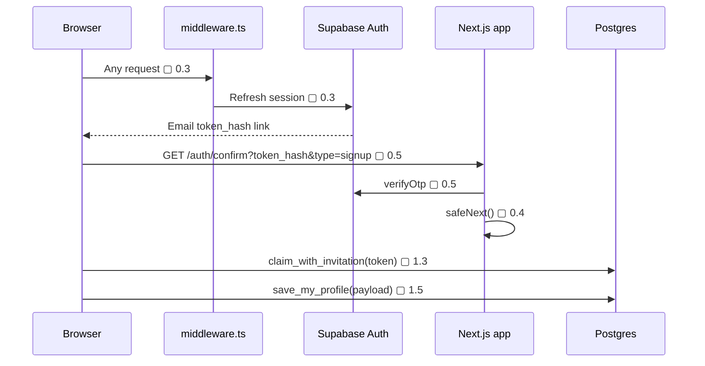

# Auth and claim technical sequence

The current sequence relies on a same-browser PKCE verifier and ignores the exchange error. The target uses token-hash confirmation, session refresh, and invitation redemption.

### Target sequence

## Notes

- **F7** — Open redirect.
- **F8** — The claim depends entirely on email confirmation.
- **F9** — Auth emails don't work for real alumni.
- **F11** — No `middleware.ts` session refresh.
- **0.3** — `middleware.ts` that refreshes the session on every request.
- **0.4** — `safeNext()` helper used by the callback and login.
- **0.5** — `/auth/confirm` (`verifyOtp` with `token_hash`) and an `/auth/error` page; keep `/auth/callback` for OAuth only.
- **1.3** — `claim_with_invitation(token)`: the tenant comes from the token. Keep tenant-aware email-match as a fallback.
- **1.5** — `save_my_profile(payload jsonb)`, one transaction, used by both onboarding and `/me`.
