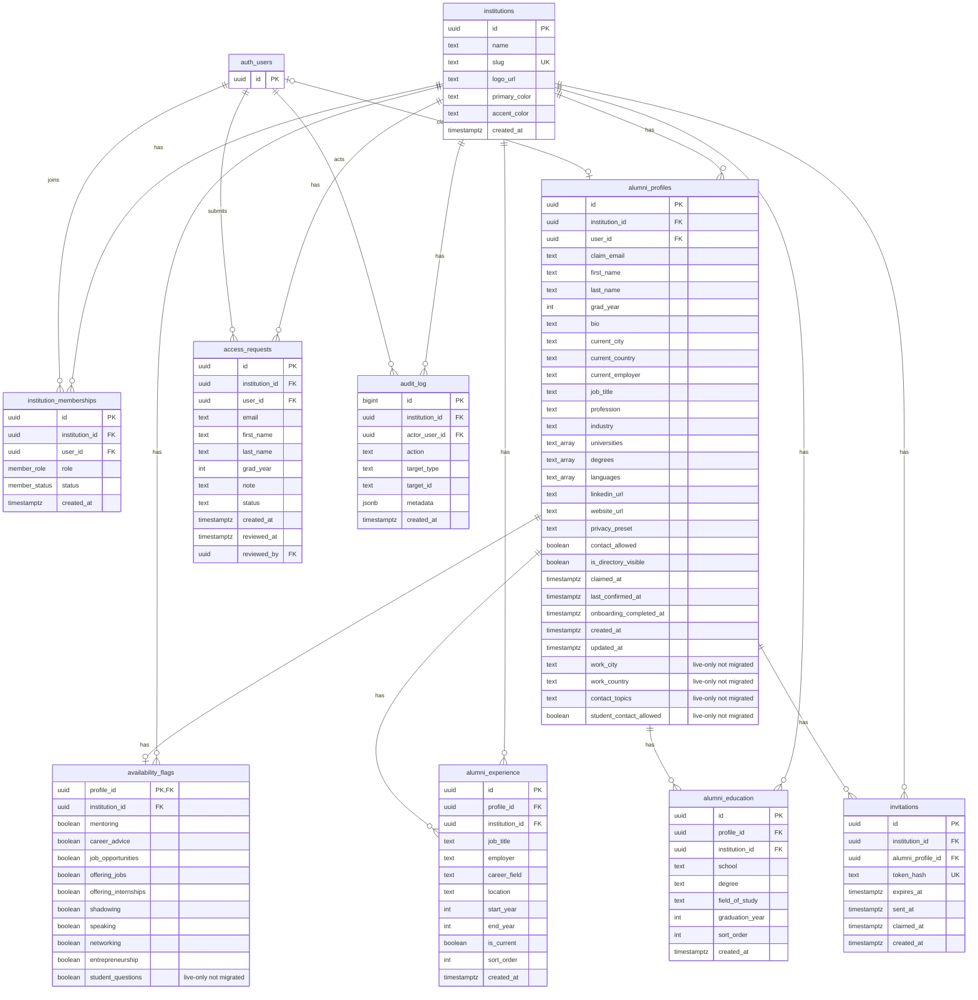

# Current schema ERD

Derived from migrations 001, 003, and 004, plus the live-only fields recorded in PRODUCT_ANALYSIS. The live database has not been independently inspected in this run. `auth_users` represents external `auth.users`.

### RLS policies today

| Table | Policy | Operation | Rule | Issue |
|---|---|---|---|---|
| institutions | institutions_read_member | SELECT | tenant member or super admin |  |
| institution_memberships | memberships_read_self_or_admin | SELECT | self or tenant admin |  |
| alumni_profiles | profiles_read_same_tenant | SELECT | owner, admin or claimed visible member | F3 every column |
| alumni_profiles | profiles_insert_admin | INSERT | tenant admin |  |
| alumni_profiles | profiles_update_owner_admin | UPDATE | owner or admin | F5 system fields |
| alumni_profiles | profiles_delete_admin | DELETE | tenant admin |  |
| availability_flags | availability_read_same_tenant | SELECT | any tenant member | F4 hidden parent |
| availability_flags | availability_write_owner_admin | ALL | owner or admin |  |
| alumni_experience | experience_read_same_tenant | SELECT | any tenant member | F4 hidden parent |
| alumni_experience | experience_owner_admin_write | ALL | owner or admin |  |
| alumni_education | education_read_same_tenant | SELECT | any tenant member | F4 hidden parent |
| alumni_education | education_owner_admin_write | ALL | owner or admin |  |
| invitations | invitations_admin_only | ALL | tenant admin |  |
| access_requests | access_request_insert_self | INSERT | authenticated self | F1 live RPC unreviewed |
| access_requests | access_request_read_self_or_admin | SELECT | self or tenant admin | F16 NULL tenant hidden |
| access_requests | access_request_admin_update | UPDATE | tenant admin | F16 NULL tenant hidden |
| audit_log | audit_admin_read | SELECT | tenant admin |  |

### SECURITY DEFINER functions

| Function | Caller or grant | Issue |
|---|---|---|
| `is_member_of`, `is_admin_of`, `is_super_admin` | No explicit revoke in migrations | Default execute grant needs review (F2) |
| `find_claimable_profile` | Explicit anon, authenticated | F6, F23 |
| `claim_my_profile` | Explicit authenticated; default PUBLIC grant not revoked | F8, F23 |
| `request_alumni_access` | Live-only; definition unknown | F1 |
| `approve_access_request` | Live-only; anon observed reaching lookup | F1, F2 |
| `reveal_contact_email` | Live-only; definition unknown | F1, F3 |

## Notes

- **F1** — The repo no longer matches the live database.
- **F2** — `approve_access_request` runs for anonymous callers.
- **F3** — Members can read every column of every visible profile.
- **F4** — Child tables leak hidden and unclaimed profiles.
- **F5** — Owners can rewrite system columns.
- **F6** — Email enumeration on `/claim`.
- **F8** — The claim depends entirely on email confirmation.
- **F16** — Access-request approval is undefined.
- **F23** — The tenant is hard-coded.
