# Target schema overview

The complete target table inventory and main relationships from PRODUCT_ANALYSIS §6. Each entity is a name with a placeholder key for readability; the domain diagrams show all fields.

```mermaid
erDiagram
auth_users {
  uuid id PK
}
institutions {
  uuid id PK
}
platform_admins {
  uuid user_id PK, FK "NEW"
}
institution_memberships {
  uuid id PK
}
consents {
  uuid id PK "NEW"
}
alumni_profiles {
  uuid id PK
}
alumni_private {
  uuid profile_id PK, FK "NEW"
}
alumni_education {
  uuid id PK
}
alumni_experience {
  uuid id PK
}
career_fields {
  uuid id PK "NEW"
}
offer_types {
  uuid id PK "NEW"
}
profile_offers {
  uuid profile_id PK, FK "NEW"
}
profile_tags {
  uuid profile_id PK, FK "NEW"
}
invitations {
  uuid id PK
}
access_requests {
  uuid id PK
}
import_batches {
  uuid id PK "NEW"
}
contact_events {
  uuid id PK "NEW"
}
messages {
  uuid id PK "NEW"
}
reconfirmation_requests {
  uuid id PK "NEW"
}
reports {
  uuid id PK "NEW"
}
audit_log {
  bigint id PK
}
student_profiles {
  uuid id PK "NEW"
}
institutions ||--o{ institution_memberships : members
institutions ||--o{ alumni_profiles : alumni
institutions ||--o{ consents : records
institutions ||--o{ invitations : sends
institutions ||--o{ access_requests : reviews
institutions ||--o{ import_batches : imports
institutions ||--o{ contact_events : logs
institutions ||--o{ messages : relays
institutions ||--o{ reconfirmation_requests : nudges
institutions ||--o{ reports : moderates
institutions ||--o{ audit_log : audits
institutions ||--o{ student_profiles : verifies
auth_users ||--o| platform_admins : operates
auth_users ||--o{ institution_memberships : joins
auth_users ||--o{ consents : accepts
auth_users |o--o| alumni_profiles : claims
alumni_profiles ||--|| alumni_private : private
alumni_profiles ||--o{ alumni_education : educated
alumni_profiles ||--o{ alumni_experience : worked
alumni_profiles ||--o{ profile_offers : offers
alumni_profiles ||--o{ profile_tags : tagged
alumni_profiles ||--o{ invitations : invited
alumni_profiles ||--o{ reconfirmation_requests : confirms
alumni_profiles ||--o{ contact_events : contacts
alumni_profiles ||--o{ messages : messages
alumni_profiles ||--o{ reports : reported
career_fields ||--o{ alumni_profiles : categorizes
career_fields ||--o{ alumni_experience : categorizes
offer_types ||--o{ profile_offers : defines
import_batches |o--o{ alumni_profiles : imports
messages |o--o{ reports : reported
```

### Enums and target RLS

Enums: `member_role`, `member_status`, `profile_status`, `profile_visibility`, `invitation_status`, `request_status`, `contact_channel`.

| Table | Access rule |
|---|---|
| `institutions` | Tenant members read; admins manage |
| `platform_admins` | Platform admins only |
| `institution_memberships` | Self and tenant admins |
| `consents` | Owner writes/reads; admins read |
| `alumni_profiles` | Member reads claimed and visible; owner edits safe fields; admin manages |
| `alumni_private` | Owner and admins only |
| `alumni_education` | Read when parent visible; owner and admins write |
| `alumni_experience` | Read when parent visible; owner and admins write |
| `career_fields` | Member reads; admin manages options |
| `offer_types` | Member reads; admin manages options |
| `profile_offers` | Read when parent visible; owner and admins write |
| `profile_tags` | Read when parent visible; owner and admins write |
| `invitations` | Anonymous peek via RPC; admin manages |
| `access_requests` | Anonymous submits via RPC; owner and admins read |
| `import_batches` | Admins only |
| `contact_events` | Insert via RPC; sender and admins read |
| `messages` | Send via RPC; parties and admins read |
| `reconfirmation_requests` | Confirm via token RPC; admins manage |
| `reports` | Member submits; admins review |
| `audit_log` | Admins read |
| `student_profiles` | Student owner and admins |

## Notes

- See [PRODUCT_ANALYSIS](../../docs/PRODUCT_ANALYSIS.md) for the source model.
