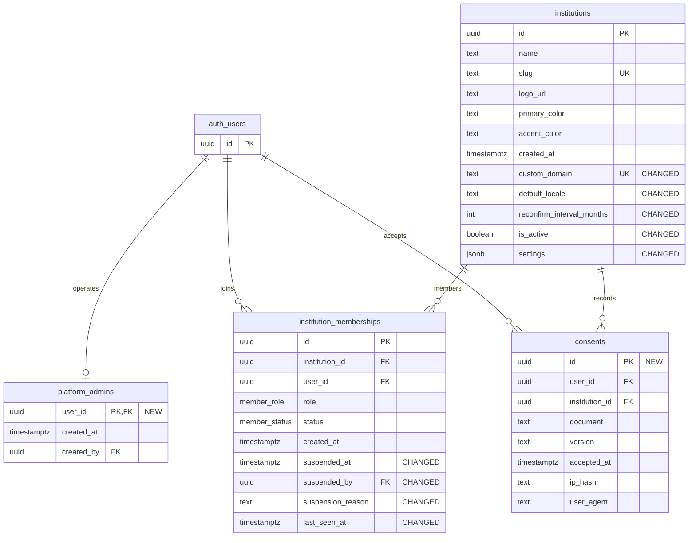

# Target identity and tenancy

Target field inventory and relationships from PRODUCT_ANALYSIS §6. The Auth user entity represents external `auth.users`; NEW and CHANGED annotations show migration impact.

### Enums and target RLS

`member_role`: institution_admin, alumni, student. `member_status`: active, suspended, revoked.

| Table | Access rule |
|---|---|
| `institutions` | Tenant members read; admins manage |
| `platform_admins` | Platform admins only |
| `institution_memberships` | Self and tenant admins |
| `consents` | Owner writes/reads; admins read |

## Notes

- See [PRODUCT_ANALYSIS](../../docs/PRODUCT_ANALYSIS.md) for the source model.
