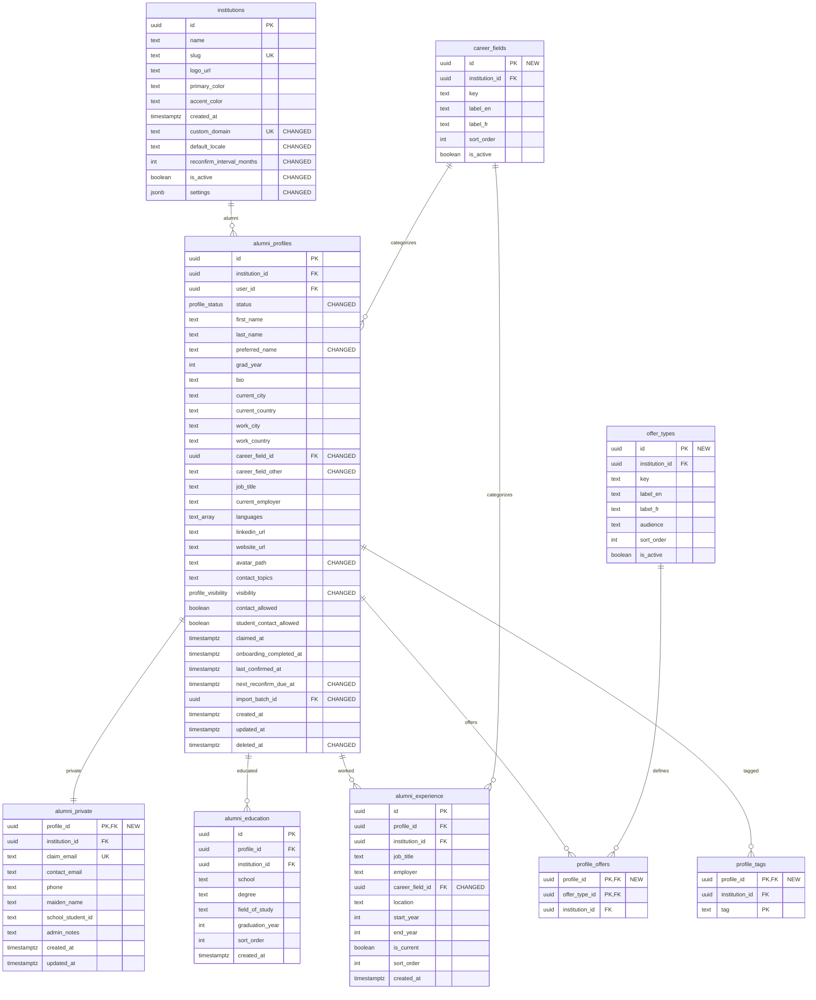

# Target profile domain

Target field inventory and relationships from PRODUCT_ANALYSIS §6. The Auth user entity represents external `auth.users`; NEW and CHANGED annotations show migration impact.

### Enums and target RLS

`profile_status`: imported, invited, claimed, suspended, archived, deceased. `profile_visibility`: hidden, members, admins_only.

| Table | Access rule |
|---|---|
| `institutions` | Tenant members read; admins manage |
| `alumni_profiles` | Member reads claimed and visible; owner edits safe fields; admin manages |
| `alumni_private` | Owner and admins only |
| `alumni_education` | Read when parent visible; owner and admins write |
| `alumni_experience` | Read when parent visible; owner and admins write |
| `career_fields` | Member reads; admin manages options |
| `offer_types` | Member reads; admin manages options |
| `profile_offers` | Read when parent visible; owner and admins write |
| `profile_tags` | Read when parent visible; owner and admins write |

## Notes

- See [PRODUCT_ANALYSIS](../../docs/PRODUCT_ANALYSIS.md) for the source model.
