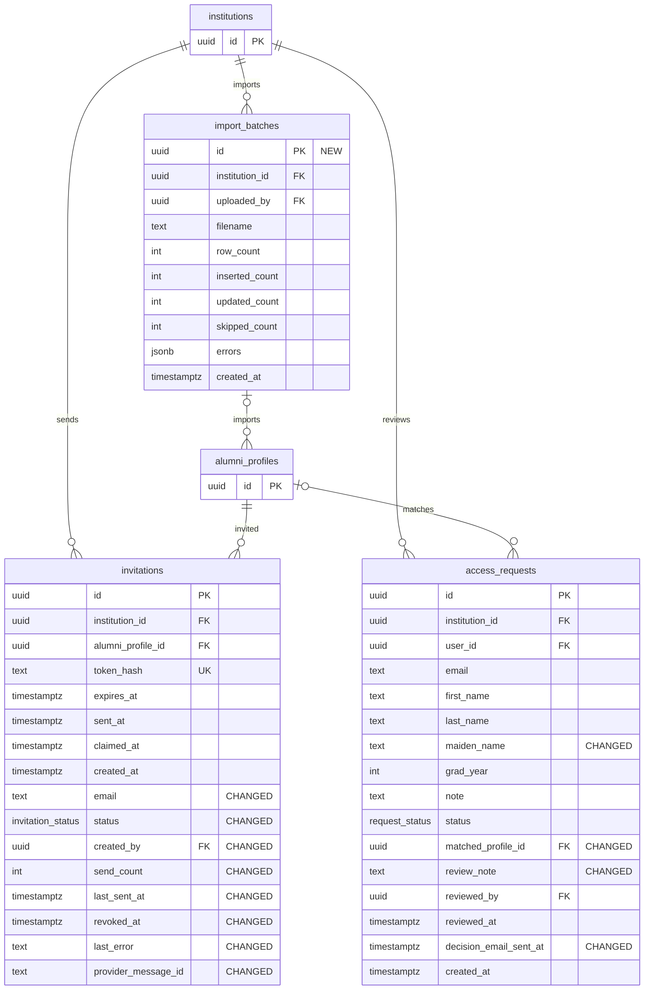

# Target onboarding and requests

Target field inventory and relationships from PRODUCT_ANALYSIS §6. The Auth user entity represents external `auth.users`; NEW and CHANGED annotations show migration impact.

### Enums and target RLS

`invitation_status`: pending, sent, bounced, claimed, expired, revoked. `request_status`: pending, needs_info, approved, rejected.

| Table | Access rule |
|---|---|
| `institutions` | Tenant members read; admins manage |
| `alumni_profiles` | Member reads claimed and visible; owner edits safe fields; admin manages |
| `invitations` | Anonymous peek via RPC; admin manages |
| `access_requests` | Anonymous submits via RPC; owner and admins read |
| `import_batches` | Admins only |

## Notes

- See [PRODUCT_ANALYSIS](../../docs/PRODUCT_ANALYSIS.md) for the source model.
