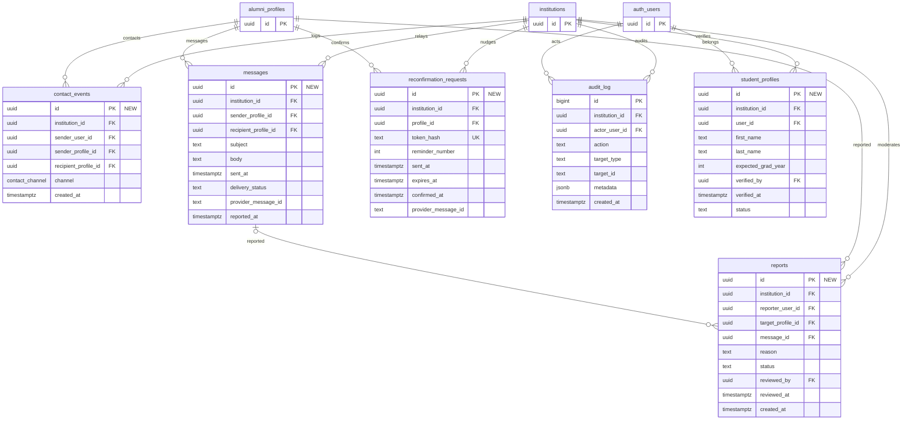

# Target engagement and safety

Target field inventory and relationships from PRODUCT_ANALYSIS §6. The Auth user entity represents external `auth.users`; NEW and CHANGED annotations show migration impact.

### Enums and target RLS

`contact_channel`: email_reveal, relay_message.

| Table | Access rule |
|---|---|
| `institutions` | Tenant members read; admins manage |
| `alumni_profiles` | Member reads claimed and visible; owner edits safe fields; admin manages |
| `contact_events` | Insert via RPC; sender and admins read |
| `messages` | Send via RPC; parties and admins read |
| `reconfirmation_requests` | Confirm via token RPC; admins manage |
| `reports` | Member submits; admins review |
| `audit_log` | Admins read |
| `student_profiles` | Student owner and admins |

## Notes

- See [PRODUCT_ANALYSIS](../../docs/PRODUCT_ANALYSIS.md) for the source model.
