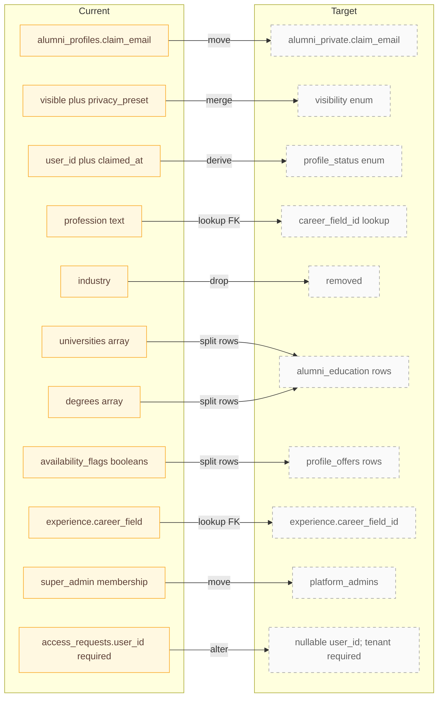

# Current to target migration map

Each arrow corresponds to the field map in PRODUCT_ANALYSIS §6.6. The checklist below orders the required migrations and identifies data backfills and rollback considerations.

### Migration checklist

1. [ ] `005_capture_live_schema` — pull production definitions; inspect live-only RPCs. Roll back by restoring captured definitions.
2. [ ] `006_security_hardening` — revoke unsafe function access, protect system fields, and fix parent-aware RLS (F2–F5). Roll back policies only after replacing equivalent protections.
3. [ ] `007_alumni_private_split` — copy claim and contact fields, validate counts, then remove public columns. Roll back from retained backup until cutover.
4. [ ] `008_visibility_and_status_enums` — derive values from current booleans and timestamps. Keep reversible mappings until all clients migrate.
5. [ ] `009_lookup_tables_and_profile_offers` — seed CAREER_FIELDS and backfill offer booleans. Retain original flags during verification.
6. [ ] `010_education_single_source` — backfill array schools and degrees into education rows. Deduplicate before removing arrays.
7. [ ] `011_invitations_and_requests_v2` — migrate tokens and statuses; require a tenant for requests. Keep old status mapping for rollback.
8. [ ] `012_engagement_tables` — create contact, reconfirmation, report, and message records. New empty tables can be removed before use.
9. [ ] `013_platform_admins` — copy super-admin memberships to separate identity rows. Keep old roles until authorization cutover.

## Notes

- **F2** — `approve_access_request` runs for anonymous callers.
- **F5** — Owners can rewrite system columns.
